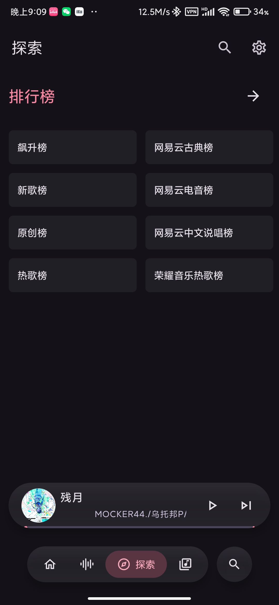
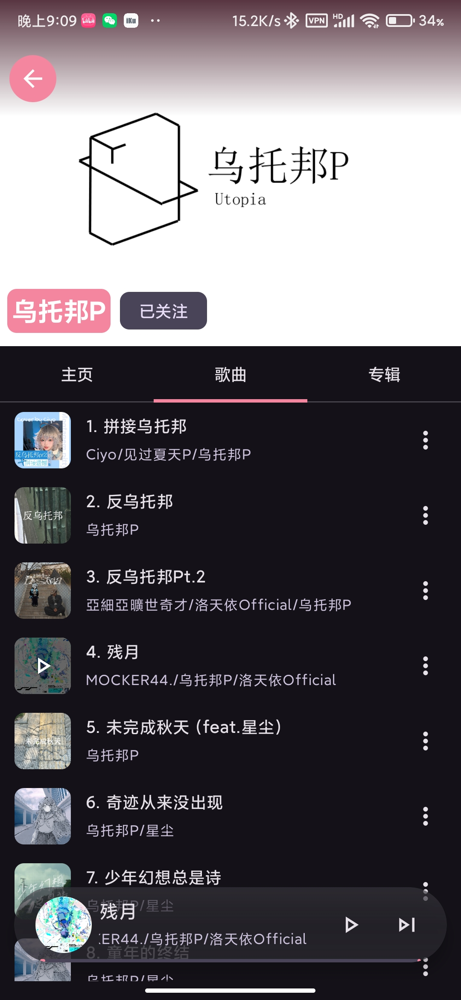
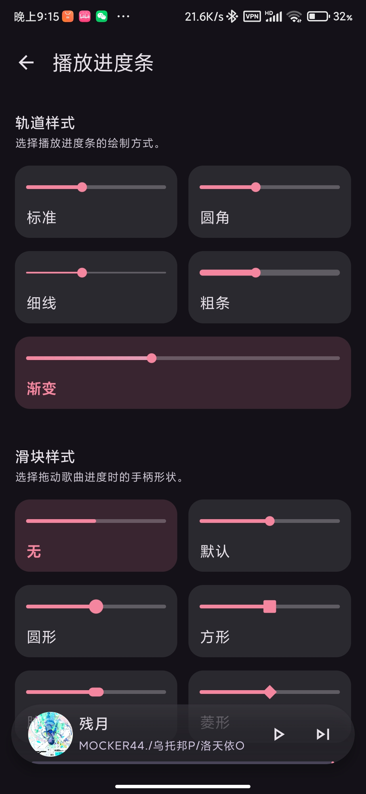
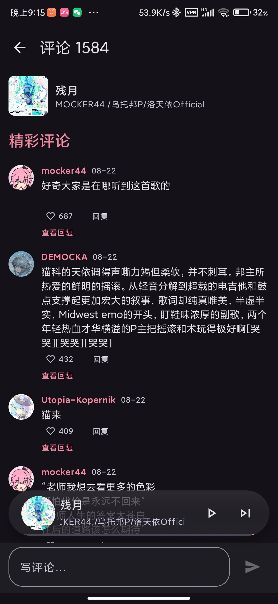

# 肥鱼音乐

一个基于 Jetmelo 魔改的安卓网易云音乐播放器

## 特点

- 支持导入洛雪 .js 音源
- 提供更多播放页
- 更多的自定义选项
- 支持扫码登录和手机号登录
- 歌词相较于原版多了翻译

## 截屏

<table>
  <tr>
    <td></td>
    <td></td>
    <td></td>
  </tr>
  <tr>
    <td></td>
    <td></td>
    <td></td>
  </tr>
  <tr>
    <td></td>
    <td></td>
    <td></td>
  </tr>
</table>

## Credit

- [InnerTune](https://github.com/z-huang/InnerTune)
- [Protobuf](https://github.com/protocolbuffers/protobuf)
- [Reorderable](https://github.com/Calvin-LL/Reorderable)
- [Ktor](https://github.com/ktorio/ktor)
- [Coil](https://github.com/coil-kt/coil)
- [Ksp](https://github.com/google/ksp)

## 免责声明

本项目为基于开源项目 JetMelo 的深度二次魔改版本（以下简称“本软件”）。在下载、安装或使用本软件前，请务必仔细阅读并同意以下条款：

1. 非官方与非原版声明：本软件由第三方个人开发者（即本人）基于开源代码深度修改而成，与网易云音乐及其关联公司无任何隶属或授权关系。同时，本软件产生的任何问题、争议，均与 JetMelo 原作者（rcmiku）无关。
2. 技术中立与脚本扩展：本软件仅提供中立的客户端界面及第三方 JavaScript 脚本的运行环境（WebView），不内置、不提供任何音源数据或破解内容。用户自行导入的脚本及其解析出的内容，均由互联网开源社区提供，本软件开发者不承担相关责任。
3. 风险自担：因使用本软件或第三方脚本产生的一切行为（包括但不限于版权纠纷、账号封禁、数据丢失、设备损坏等），均由用户自行承担。本软件开发者不对上述任何直接或间接损失承担连带责任。
4. 魔改风险提示：由于本软件为个人魔改版，可能存在未知的 Bug 或不稳定因素。强烈建议用户仅用于个人技术学习与研究，严禁任何形式的商业倒卖或二次打包。
5. 支持正版：请务必在下载相关音频后 24 小时内删除。强烈呼吁大家前往官方平台开通会员，支持正版音乐。
