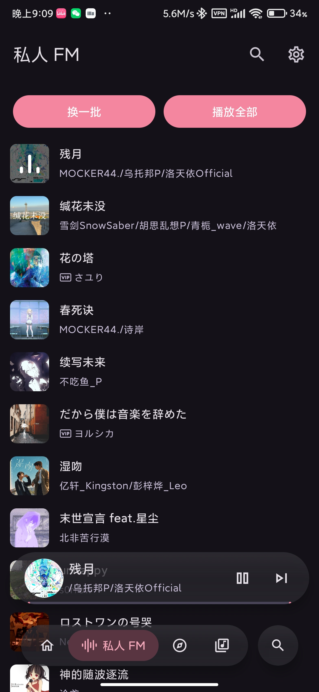
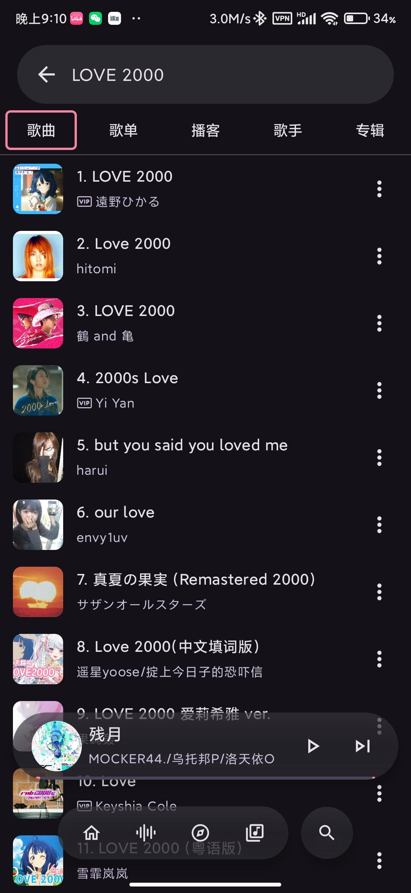
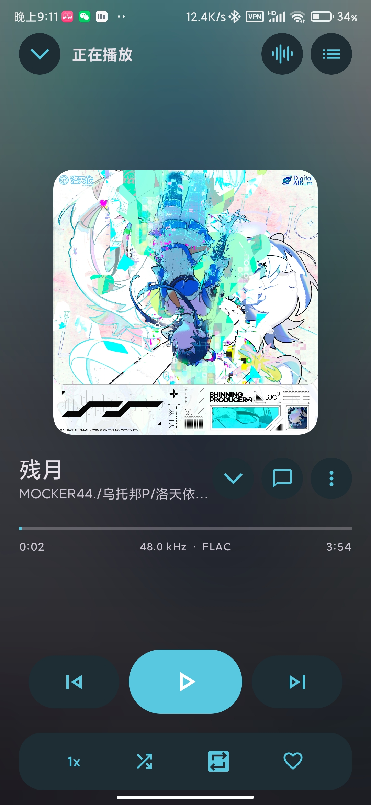

# 肥鱼音乐

一个基于 Jetmelo 魔改的安卓网易云音乐播放器

## 特点

- 支持导入洛雪 .js 音源
- 提供更多播放页
- 更多的自定义选项
- 支持扫码登录和手机号登录
- 歌词相较于原版多了翻译

## Screenshot

<table>
  <tr>
    <td></td>
    <td></td>
    <td></td>
  </tr>
  <tr>
    <td></td>
    <td></td>
    <td></td>
  </tr>
  <tr>
    <td></td>
    <td></td>
    <td></td>
  </tr>
</table>

## Credit

- [InnerTune](https://github.com/z-huang/InnerTune)
- [Protobuf](https://github.com/protocolbuffers/protobuf)
- [Reorderable](https://github.com/Calvin-LL/Reorderable)
- [Ktor](https://github.com/ktorio/ktor)
- [Coil](https://github.com/coil-kt/coil)
- [Ksp](https://github.com/google/ksp)

## 免责声明

This software is not affiliated with, funded, authorized, or endorsed by NetEase Cloud Music, Hangzhou NetEase Cloud Music Technology Co., or any of its affiliates.

This software does not provide any VIP audio decryption or unlocking services. You must obtain the appropriate membership on the respective platform to access such content.

This software is for learning and communication purposes only and should not be used for commercial purposes.

Any trademarks, service marks, trade names, or other intellectual property rights used in this software belong to their respective owners.
